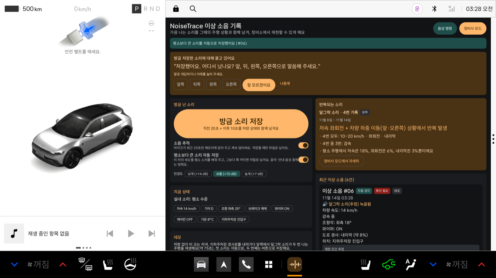
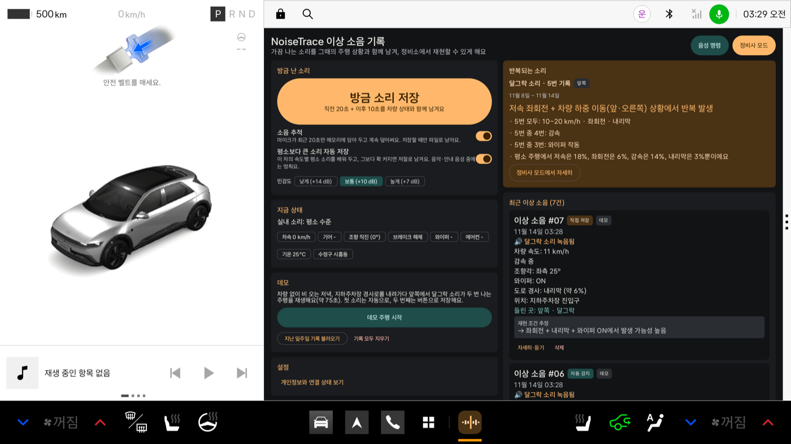
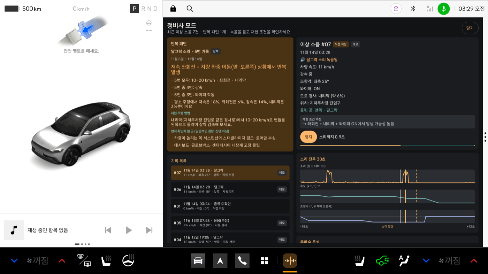
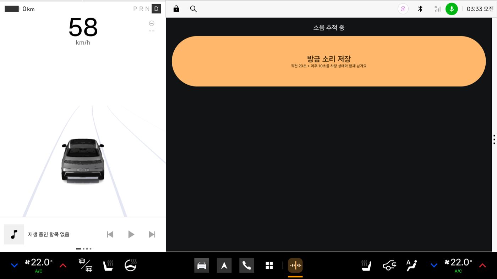

# NoiseTrace — 간헐 소음을 그때의 주행 상황과 함께 기록하는 차량용 앱

현대자동차그룹 차량용 앱 개발 공모전(Pleos Connect) 출품 후보입니다. 이전 주제(Calm Ride, 전기 택시 멀미)는 `main` 브랜치에 있고, 이 `noise-trace` 브랜치는 주제를 바꾼 버전입니다.

> 재현하기 어려운 간헐적 차량 소음을 발생 당시의 주행 맥락과 함께 기록해 정비 가능한 정보로 바꾸는 차량용 앱

- **지나간 소리까지:** 마이크 소리를 최근 20초만 메모리에 담아 두다가, 「방금 소리 저장」을 누르면 **직전 20초 + 이후 10초**를 남깁니다.
- **자동 저장:** 이 차의 속도별 평소 소리를 배워 두고, 그보다 확 커지면 저절로 남깁니다.
- **소음 사건:** 소리와 함께 그 순간의 차속·가감속·조향각·브레이크·기어·와이퍼·에어컨·창문·기온·경사·방지턱·위치를 하나로 묶고, "저속 + 좌회전 + 내리막에서 발생 가능성 높음"처럼 재현 조건을 추정합니다.
- **패턴:** 같은 소리가 쌓이면 공통 조건을 찾습니다. 평소 주행에서도 흔한 조건은 원인 후보에서 뺍니다. 예: "저속 좌회전 + 차량 하중 이동(앞·오른쪽) 상황에서 반복 발생".
- **정비사 모드:** 정비소에서 차량 화면으로 녹음을 듣고, 전후 30초의 소리·속도·조향 그래프, 주파수, 재현 주행 방법을 확인합니다.

기획 내용 전체는 [`docs/02_기획/NoiseTrace_기획안.md`](docs/02_기획/NoiseTrace_기획안.md)에 있습니다.

## 화면

| | |
| --- | --- |
|  |  |
| 데모 주행 중 자동 저장된 리포트와 음성 질문 | 같은 달그락 소리 5건의 공통 조건 |
|  |  |
| 정비사 모드: 녹음 재생과 전후 30초 그래프 | 주행 중에는 큰 버튼 하나만 (Virtual Console로 58 km/h 주행) |

## 주요 기능

| 기능 | 설명 | 사용하는 SDK·API |
| --- | --- | --- |
| 방금 소리 저장 | 직전 20초 + 이후 10초를 WAV(16 kHz)로 남깁니다. 메모리에서 평소보다 크게 튄 **마지막 순간**을 찾아 발생 시점으로 삼고, 차량 상태는 그 시점 기준으로 기록합니다. 뚜렷한 소리가 없으면 "버튼 2초 전으로 봄"이라고 표시합니다. 음성("방금 소리 저장")으로도 됩니다. | Android `AudioRecord`, Pleos SpeechToText |
| 평소보다 큰 소리 자동 저장 | 속도 구간 6개마다 실내 소리 분포를 1 dB 단위로 배웁니다. 전체 대역은 '웅웅'을, 400 Hz 이상은 '달그락·삐걱'을 봅니다. 1초 중 0.3초가 평소보다 10 dB 크거나 한순간 18 dB 크면 저장합니다. 민감도는 낮게·보통·높게 중에서 고릅니다. 음악, 앱 음성, 재생 중, 창문 열림일 때는 멈춥니다. 저장 뒤 30초는 쉬고 한 시간에 최대 6건입니다. | AAOS `PERF_VEHICLE_SPEED`, `AudioManager.isMusicActive` |
| 소음 사건 | 소리 크기(평소 대비 dB), 옥타브 대역별 증가량, 주요 주파수, 소리 모양으로 추정한 종류를 함께 저장합니다. 차량 상태로는 속도, 가감속, 조향각, 브레이크, 기어, 방향지시등, 모터 회전수(차속 추정), 누적 주행거리, 와이퍼, 에어컨, 창문, 바깥 기온을 남깁니다. 주행 환경으로는 경사, 도로 유형, 방지턱·노면 파손 통과, 위치, GPS 약함을 남깁니다. 전후 30초의 속도·조향 흐름도 저장합니다. | Pleos Vehicle SDK `Brake`·`TurnSignal`·`SteeringWheel`·`Wiper`·`HVAC`·`Window`·`Odometer`, AAOS `GEAR_SELECTION`·`ENV_OUTSIDE_TEMPERATURE`, NaviHelper, FusedLocation |
| 음성으로 태그 | 저장이 끝나면 "어디서 났나요?"(앞·뒤·왼쪽·오른쪽), "어떤 소리였나요?"(달그락·삐걱·웅웅)를 묻습니다. 같은 주행에서 또 저장하면 "아까와 같은 소리인가요?"만 묻습니다. 저장 중 10초 동안은 앱이 말하지 않습니다(녹음에 섞이지 않도록). | Pleos TextToSpeech / SpeechToText (ON_DEVICE) |
| 재현 조건 추정 | 속도 구간을 맨 앞에 두고, 그다음은 이 차의 평소 주행에서 드문 움직임(회전·감속·경사·방지턱) 순서입니다. 와이퍼·에어컨은 남은 자리만 채웁니다. | — |
| 반복 패턴 | 같은 종류 2건 이상에서 80% 이상 겹치는 조건을 찾습니다. 평소 주행 비율보다 1.5배 이상 잦은 조건만 남기고, 하중이 쏠리는 방향(앞·뒤·좌·우)을 붙입니다. 재현 주행 방법과 점검 후보(참고용)도 보여 줍니다. | — (주행 중 1초마다 조건별 시간을 셈) |
| 정비사 모드 | 정차 중에만 녹음을 재생합니다(발생 5초 전부터 또는 30초 전체). 소리·속도·조향각 30초 그래프에 발생 시점과 버튼 누른 시점을 표시하고, 대역별 증가량 막대와 기록된 차량 상태 전체를 보여 줍니다. | Android `AudioTrack` (오디오 포커스 `GAIN_TRANSIENT`) |
| 주행 중 화면 | 주행 최적화(DO)를 선언했습니다. 주행 중에는 큰 저장 버튼 하나와 질문 문장만 보입니다. | AAOS `CarUxRestrictionsManager` |
| 데모 | 차량 없이 비 오는 저녁 지하주차장 경사로를 재생합니다(약 75초). 첫 달그락은 자동, 두 번째는 버튼으로 저장합니다. '지난 일주일 기록 불러오기'를 함께 쓰면 반복 패턴 5건이 됩니다. | 합성 실내 소음 → 실제와 같은 저장 경로 |

## 구조

```
app/src/main/java/com/noisetrace/
├── core/        순수 Kotlin 로직 (단위 테스트 대상)
│   ├── AudioRing        최근 20초 링 버퍼
│   ├── Levels           RMS dB, 400 Hz 고역 필터
│   ├── NoiseDetector    속도 구간별 평소 소리(Baseline)와 자동 감지 규칙
│   ├── CapturePipeline  100 ms 프레임 처리, 버튼·자동 저장, 발생 시점 찾기
│   ├── SpectrumAnalyzer 저장 후 한 번: FFT, 옥타브 대역, 종류 추정
│   ├── DrivingContext   발생 시점의 차량 상태, 조건, 경사·방지턱·도로 유형
│   ├── NoiseEvent, EventFactory, StoragePolicy
│   ├── NoiseReport      리포트 문장, 재현 조건 추정, 반복 패턴, 점검 후보
│   ├── DemoScript, DemoSounds, SampleHistory   데모 주행과 합성 소리
│   └── VoiceCommandParser, StopDetector, Wav
├── audio/       CabinRecorder(마이크 → 파이프라인), ClipPlayer(정비사 모드 재생)
├── vehicle/     Pleos Vehicle·NaviHelper·FusedLocation SDK, AAOS Car API
├── voice/       Pleos TextToSpeech·SpeechToText
├── runtime/     NoiseTraceController(전체 연결), NoiseTraceService(포그라운드, 마이크), DemoDrive
├── data/        EventStore (차량 내부 저장: 사건 JSON + WAV, 설정, 평소 소리, 주행 조건 시간)
└── ui/          홈, 주행 중 화면, 정비사 모드 (Jetpack Compose)
```

## 빌드

필요한 환경은 JDK 17, Android SDK(Platform 35, Build-Tools 35)입니다. Pleos SDK는 공개 Maven 저장소(`https://nexus-playground.pleos.ai/repository/maven-releases/`)에서 받습니다.

```bash
./gradlew :app:testDebugUnitTest
```

```bash
./gradlew :app:assembleRelease
```

- 단위 테스트는 46개입니다. 데모 주행 전체를 파이프라인에 넣어 기획 예시 리포트가 나오는지도 확인합니다.
- 빌드된 APK는 [`apk/NoiseTrace_release.apk`](apk/NoiseTrace_release.apk)에 있습니다. 공모전 제출 규칙에 맞추려면 이름을 `팀명_NoiseTrace_release.apk`로 바꾸세요. 데모용 디버그 키로 서명되어 있습니다.

## Pleos Connect 에뮬레이터에서 실행

에뮬레이터는 Pleos Connect Emulator v2.1.0(Android 14, API 34, arm64-v8a, 2560×1440)이고, Cold boot로 부팅합니다.

1. `adb install -r -g apk/NoiseTrace_release.apk`로 설치하고 실행합니다.
2. '소음 추적'을 켭니다. 마이크 권한을 허용하면 상단에 마이크 사용 표시가 뜹니다.
3. 데모를 보려면 '지난 일주일 기록 불러오기' → '데모 주행 시작' 순서로 누릅니다. 약 75초 뒤 반복 패턴이 5건이 되고, 「정비사 모드」에서 녹음과 그래프를 볼 수 있습니다.
4. 실제 차량 신호로 보려면 `adb forward tcp:8088 tcp:8088` 후 `http://127.0.0.1:8088/` Virtual Console에서 기어를 D로 바꾸고 가속합니다. 앱이 주행 중 화면으로 바뀝니다. 「방금 소리 저장」을 누르면 그 순간의 차속·조향·에어컨·위치가 담깁니다.

## 플랫폼 규칙 준수

- **자원:** 상시 처리는 100 ms마다 필터 1개와 RMS 2개뿐이고, FFT는 저장 후에 한 번만 합니다. 측정값은 아래 검증 결과에 있습니다(기준: CPU 5% 미만, RAM 400 MB 이하). 링 버퍼는 640 KB입니다. 저장 공간은 최대 50건·64 MB이며, 넘으면 확인하지 않은 자동 저장부터 지웁니다.
- **마이크:** Android 14 규칙에 따라 포그라운드 서비스 유형을 `microphone`으로 선언했고, 마이크 권한이 있을 때만 이 유형으로 시작합니다. 알림에 마이크 사용을 표시합니다. 자동 이득 조절이 없는 `UNPROCESSED`(없으면 `VOICE_RECOGNITION`) 소스를 씁니다.
- **주행 중 화면:** `distractionOptimized`를 선언하고, 주행 중에는 버튼 하나와 질문 문장만 보여 줍니다. 태그는 음성 한 단어로 받습니다.
- **오디오 포커스:** 녹음 재생은 `AUDIOFOCUS_GAIN_TRANSIENT`로 요청하고, 포커스를 잃으면 멈춥니다. 정차 중에만 재생합니다.
- **차속·기어:** Pleos 정책(AAOS Alignment)에 따라 AAOS `PERF_VEHICLE_SPEED`, `GEAR_SELECTION`으로 읽습니다.
- **개인정보:** 소음 추적은 사용자가 켜야 동작합니다. 메모리의 소리는 20초마다 덮어쓰고, 기록은 차량 안에만 저장하며 밖으로 보내지 않습니다. 위치 저장은 끌 수 있습니다. 대화가 섞일 수 있는 자동 저장은 '확인 필요'로 표시합니다.

## 에뮬레이터 검증 결과 (2026-11-14)

| 항목 | 결과 |
| --- | --- |
| 실행 | 설치·실행 정상. 홈 화면이 앱을 `distractionOptimized: true`로 인식 |
| 마이크 | '소음 추적'을 켜자 `VOICE_RECOGNITION` 소스로 녹음 시작. 차량 AI의 상시 `HOTWORD` 녹음과 함께 "not silenced". 상단 마이크 표시 켜짐. 정차 상태의 평소 소리를 배운 뒤 "실내 소리: 평소 수준" 표시 |
| 차량 신호 | 와이퍼, 에어컨, 바깥 기온(25°C), 조향각, 기어, 차속, 내비 주소("수정구 시흥동")가 앱에 표시됨 |
| 직접 저장 (정차) | 버튼 → 10초 뒤 #01 저장, 위치 질문 카드와 음성 질문 |
| 데모 주행 | 44초에 달그락을 **자동 저장**: 14 km/h, 감속 중, 좌측 18°, 와이퍼 ON, 내리막 약 8%, 지하주차장 진입구, 평소보다 +20 dB. 59.5초 버튼 → 1.9초 전 달그락을 찾아 저장. "아까와 같은 소리" 대답으로 태그 복사 |
| 반복 패턴 | 지난 일주일 3건 + 데모 2건으로 "저속 좌회전 + 차량 하중 이동(앞·오른쪽) 상황에서 반복 발생, 5번 모두: 10~20 km/h · 좌회전 · 내리막" |
| 정비사 모드 | 녹음 재생 시 `USAGE_MEDIA` 오디오 포커스 요청과 재생 위치 표시. 30초 그래프, 2 kHz 대역 +33 dB 막대, 차량 상태 전체 표시 |
| 주행 중 (실제 신호) | Virtual Console로 D, 58→120 km/h. 시스템이 화면을 막지 않고 앱이 큰 버튼 화면으로 전환. 버튼으로 #08 저장(84 km/h, 가속 중, 에어컨 ON, 위치 포함) |
| 자원 사용 | 메모리 PSS 81.8~87.7 MB, CPU 0.5~1.5% (소음 추적 켬) |

검증 중에 찾아서 고친 것도 있습니다.
- **조향각 부호:** Virtual Console에서 왼쪽 −90°로 돌리면 SDK가 +90을 보냅니다(AAOS 설명과 반대). 앱 안에서는 왼쪽을 −로 쓰므로 SDK 값을 한 곳에서 뒤집었습니다. 수정 후 콘솔 −30°가 "좌측 30°"로 표시됩니다.
- **데모 뒤 차량 상태가 비는 문제:** 데모 동안에도 실제 차량 신호를 따로 기억했다가, 데모가 끝나면 되돌리도록 고쳤습니다.
- **번호 순서:** '지난 일주일 기록'을 나중에 불러오면 번호가 날짜와 어긋났습니다. 날짜 순으로 다시 매기도록 고쳤습니다.

### 아직 확인하지 못한 것

- [ ] 일반 앱의 상시 마이크 사용과 주행 중 DO 화면이 Pleos 앱 심사에서 허용되는지 (주최 측 문의)
- [ ] 실차 실내 마이크 위치와 실제 소리 크기에 맞춘 민감도. 에뮬레이터 검증은 합성 실내 소음으로 했습니다.
- [ ] 실차 조향각 부호 (에뮬레이터는 왼쪽이 +)
- [ ] 지하 경사로처럼 GPS가 끊기는 곳의 경사. 기울기 센서 API가 없어 GPS 고도에 의존합니다.
- [ ] `onCautionPointInfo`(방지턱·노면 파손)가 경로 안내 없이도 오는지
- [ ] SpeechToText 대답 인식. 에뮬레이터 TTS가 `ON_DEVICE_ENGINE_ERROR`로 소리를 내지 못해 화면 버튼과 데모 대본으로 확인했습니다.
- [ ] 대화가 많은 차에서 자동 감지가 얼마나 자주 잘못 걸리는지

## 문서

| 문서 | 내용 |
| --- | --- |
| [02_기획/NoiseTrace_기획안.md](docs/02_기획/NoiseTrace_기획안.md) | 문제, 소음 사건 구성, 감지 규칙, 리포트·패턴·정비사 모드, SDK 사용 계획, 심사 기준, 사업성, 한계 |
| [01_공모전_요강.md](docs/01_공모전_요강.md) | 일정, 제출물, 심사 기준 |
| [04_Pleos_SDK_조사.md](docs/04_Pleos_SDK_조사.md), [05_구현_가능성_조사.md](docs/05_구현_가능성_조사.md) | Calm Ride 때 조사한 Pleos 플랫폼 자료 (DO, 오디오 포커스, 자원 기준, 에뮬레이터 설정은 그대로 적용) |
| [screenshots/](docs/screenshots/) | 에뮬레이터 화면 |

NoiseTrace는 소음을 진단하지 않습니다. 정비사가 소리를 재현하고 원인을 찾도록 돕는 기록 앱입니다.
