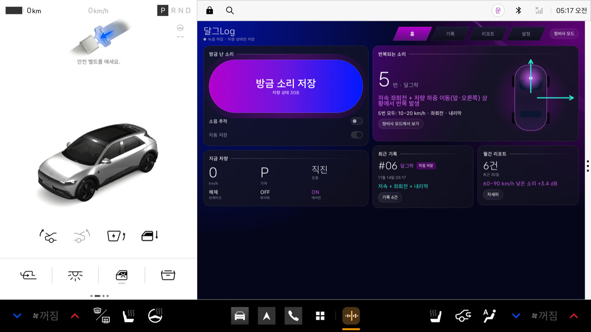

# 달그Log 기획안 — 간헐 소음을 정비 가능한 정보로

> **한 문장 정의:** 재현하기 어려운 간헐적 차량 소음을 발생 당시의 주행 맥락과 함께 기록해 정비 가능한 정보로 바꾸는 차량용 앱

정리일: 2026-11-15 · 제출 주제로 확정 · 이전 주제(Calm Ride, 전기 택시 멀미)는 `calm-ride` 브랜치에 보관했습니다.

## 한눈에 보기

**달그Log는 녹음 앱이 아니라, 잡소리가 어떤 상황에서 반복되는지 찾아 주는 앱입니다.** 정비소에서 "지금은 안 나네요"로 끝나던 소리를, 정비사가 그 소리를 다시 낼 수 있는 운전 방법(**재현 주행 방법**)으로 바꿉니다.

> **용어:** **Pleos Connect**는 현대차그룹의 새 차량 화면 시스템이고, Pleos SDK는 앱에 차량 데이터를 열어 주는 개발 도구입니다. **재현 주행 방법**은 정비사가 시험 운전 때 따라 하면 그 소리를 다시 들을 수 있는 운전 방법입니다.

```
달그락 소리 · 5번 기록 · 모두 앞쪽
공통 조건: 10~20 km/h · 좌회전 · 내리막 (5번 중 4번은 감속 중)
평소 운전 시간 중 좌회전은 6%, 내리막은 3%뿐 → 소리와 관련이 큰 조건
재현 주행 방법: 내리막길에서 10~20 km/h로 핸들을 왼쪽으로 돌리며 살짝 감속해 보세요.
```

| 단계 | 운전자가 하는 일 | 앱이 하는 일 |
| --- | --- | --- |
| ① 남기기 | 소리가 나면 버튼 한 번 (놓쳐도 자동 저장) | 늘 기억하는 최근 20초에서 소리가 커진 순간을 찾고, **그 순간의 차량 상태**(속도·핸들 각도·브레이크·와이퍼·경사·노면)를 함께 저장 |
| ② 묻기 | "앞쪽", "달그락" 한 단어로 답하기 | 음성으로 위치·종류 질문 (주행 중엔 화면을 큰 버튼 하나로) |
| ③ 찾기 | — | 평소 주행에서도 흔한 조건은 빼고, 소리 날 때만 겹치는 조건과 재현 주행 방법을 정리 → 정비사 모드 |

**두 가지 쓰는 방법: 녹음하지 않아도 핵심이 동작합니다.** (앱 화면의 이름 그대로)

| 쓰는 방법 | 쓰는 것 | 되는 것 |
| --- | --- | --- |
| 녹음 없이 쓰기 (기본) | 차량 데이터만: Pleos Vehicle SDK · NaviHelper · FusedLocation · 음성 합성·인식(TTS/STT), AAOS Car API | 버튼 앞 20초·뒤 10초의 차량 상태, 말로 답하기(음성 인식만 하고 녹음은 안 함), 반복 조건·재현 주행 방법, 정비사 모드, 월간 리포트 |
| 소음 추적 켜기 (녹음 동의 시) | 위 + 실내 마이크 | 버튼보다 먼저 난 소리 20초, 평소보다 큰 소리 자동 저장, 녹음 재생·주파수 분석, 차 소리 변화 리포트 |

- **시연:** [시연 영상 (3분 14초)](../video/달그Log_시연영상.mp4) · [APK](../../apk/남자셋_달그Log_release.apk) · Pleos Connect 에뮬레이터에서 실제로 동작하는 앱
- **다음 단계 (계획):** 차주가 보내기를 누르면 정비소가 방문 전에 기록을 받고, 실제 수리 결과로 배우는 AI가 원인 후보를 정리합니다(2-8).
- **사업성:** Pleos Connect 탑재 차량이 늘수록 쓸 수 있는 차가 늘고, 제조사는 '한 번에 고치는 정비'로 신뢰를 얻고, 차종별 반복 소음 조건이라는 현장 품질 데이터를 얻습니다(8절).



## 1. 문제

정비소에서 자주 반복되는 대화입니다.

> 고객: "앞에서 뭔가 달그락거리는데요."
> 정비사: "언제 나는데요?"
> 고객: "가끔 나요…"
> 정비사: "지금은 안 나네요."

간헐 소음은 **특정 조건에서만** 납니다. 예를 들면 저속, 좌회전, 내리막, 비 오는 날이 겹칠 때입니다. 운전자는 그 조건을 기억하지 못하고, 정비사는 소리를 들을 수 없습니다. 그래서 진단이 "재현 불가"로 끝나고 고객은 다시 방문합니다.

근거 자료 (조사일 2026-11-14):

| 내용 | 수치 | 출처 |
| --- | --- | --- |
| 현대차 국내 필드(품질) 클레임 중 소음·진동 | 약 30%, 그중 약 70%가 차체·섀시의 이음(BSR) | 현대차 수원하이테크센터 서비스엔지니어의 현장 발언(집계 기간·분모는 기사에 없음), 머니투데이 2026-06-30 — [기사](https://www.mt.co.kr/industry/2026/06/30/2026063011304531352) |
| 자동차 품질 불만 중 소음·진동 | 1,290건 중 351건으로 1위 (약 27%) | 한국소비자원 보도자료, 2009-12-17 (2008-01~2009-09 품질보증기간 안의 승용차 상담 분석) — [뉴스와이어](https://www.newswire.co.kr/newsRead.php?no=446913) |
| 구입 3년 이내 차량의 '주행 시 바람소리 심함' | 지적률 6.3%로 2위 (23,491명 조사) | 마케팅인사이트(현 컨슈머인사이트) 2014년 조사, 비즈한국 2015-01-29 보도 — [비즈한국](https://bizhankook.com/articles/5597.html) |
| 전기차의 소음·잡소리 문제 | 30.2건/100대 (내연기관차의 1.5배), 구입 1년 이내 | 컨슈머인사이트 제23차 자동차기획조사(2023-07) — [보고서](https://www.consumerinsight.co.kr/boardView.aspx?no=3445&id=pr4_list)·[더위드카 보도](https://car.withnews.kr/news/electric-vehicle-initial-quality) |
| 첫 방문에 수리 안 된 이유 (미국 딜러 서비스) | 22%가 "딜러가 문제를 못 찾음" | J.D. Power 2016 U.S. CSI, Auto Remarketing 2016-03-16 — [기사](https://www.autoremarketing.com/ar/analysis/recalls-trigger-decline-dealer-service-satisfaction) |
| 원인 미발견(TNF) 등 미해결 보증 작업 (북미) | 제조사에 따라 보증비용의 최대 38% | SAE 2024-01-5071 (Stellantis·미시간공대) — [논문 정보](https://saemobilus.sae.org/papers/warranty-repairs-reimagined-machine-learning-statistical-pattern-recognition-part-1-2024-01-5071) |
| 전기차에서 노면·풍절음이 더 도드라짐 | 엔진이 가리던 소리가 드러남 | 현대차그룹 뉴스룸 2025-10-02 — [기사](https://www.hyundaimotorgroup.com/ko/story/CONT0000000000188501) |
| 정비 지침의 녹음 요구 | 위치를 못 찾은 실내 잡소리는 녹음, 재현 안 되면 고객 녹음도 인정. 실내 소음 보증 청구는 설문지와 녹음·영상이 있어야 가능 | 벤틀리 딜러 기술문서 TPI 2056582/3 (2020-07-03), NHTSA에 제출된 게시본 — [PDF](https://static.nhtsa.gov/odi/tsbs/2020/MC-10178013-0001.pdf) |

> 국내 정비소의 공식 "녹음해 오세요" 안내 자료는 찾지 못했습니다. 한국소비자원 수치는 2008~2009년, J.D. Power·SAE 수치는 미국 자료입니다.

### 1-1. 지금의 방법으로는 왜 안 되나

| 방법 | 지나간 소리 | 그때의 차량 상태 | 운전 중 안전 | 반복 조건 정리 | 한계 |
| --- | --- | --- | --- | --- | --- |
| 고객 스마트폰 영상 (현대차가 NVH Lab SW로 주파수 분석) | ✗ 소리가 난 뒤 켜면 이미 지나감 | ✗ | ✗ 운전 중 휴대폰 조작 | ✗ | 늦게 켜면 놓침. 그때의 차 상태가 없어 다시 날 때까지 기다려야 함 |
| 블랙박스 | △ 상시 녹화에 남을 수 있지만 몇 시간 영상에서 직접 찾아야 함 | △ 영상·속도 정도. 조향·와이퍼·경사 없음 | ○ | ✗ | 앞유리 쪽 마이크, 압축 음질 |
| 정비소 소음 측정 장비 (부품에 무선 마이크를 붙이고 시험 주행. 현대차는 노이즈 옵저버·노이즈 스코프·사운드 카메라) | ✗ 정비소에서 소리가 다시 나야 함 | ✗ | — | ✗ | 언제 나는지 모르면 시험 주행이 길어짐 |
| 제조사 원격 진단 (리모트케어 데이터 기반 정비) | — | ○ 고장 시점 데이터 | ○ | ✗ | 블루링크 가입·일부 차종만. 고장 코드·제어기 통신 데이터 중심이라 소음은 잘 남지 않음 |
| 현대차 정비 거점 기록 장비 (증상 때 버튼 → 전후 통신 데이터 저장, DLog Lab SW로 분석) | ✗ 통신 데이터만, 소리 없음 | ○ 버튼 누른 시점 기준 | ○ | ✗ | 정비 거점에서 장비를 따로 달아야 함 |
| **달그Log** | ○ 버튼 전 20초 + 자동 저장 | ○ 차속·조향·브레이크·와이퍼·에어컨·경사·노면·위치 | ○ 큰 버튼 하나, 음성 한 단어 | ○ 평소 주행과 비교해 드문 조건만 | 실제 차 소리로 정확도 검증 필요 |

현대차 정비 거점도 이 문제를 이미 풀고 있습니다. 원격 진단으로 부족하면 차에 기록 장비를 달아 증상 때 버튼으로 전후 통신 데이터를 남기고, 노이즈 옵저버·노이즈 스코프·사운드 카메라로 소음을 찾고, 고객이 스마트폰으로 찍어 보낸 소음 영상을 NVH Lab SW로 주파수 분석합니다([뉴스1, 2026-11-11](https://www.news1.kr/industry/auto-industry/6349371), 파이낸셜뉴스 전재). 달그Log가 다른 점은 세 가지입니다.

1. **소리가 실제로 난 순간의 차 상태:** 버튼 직전 20초에서 소리가 튄 순간을 찾아, 그때의 차속·조향·브레이크·경사를 남깁니다(마이크 동의 시. 녹음 없이 쓰면 버튼 2초 전으로 봄). 기존 기록 장비는 버튼을 누른 시점 전후의 통신 데이터만 남기고 소리는 남기지 않습니다.
2. **장비 없이 평소 운전 중에:** 정비 거점에서 장비를 달고 돌려받을 필요가 없습니다. 모든 Pleos 차에서 출고 직후부터, 고객이 평소처럼 운전하는 동안 기록합니다.
3. **재현 방법까지:** 여러 번의 기록에서 평소 주행과 다른 조건만 골라, 정비사가 따라 할 재현 주행 방법으로 바꿉니다. 기존 방식은 데이터를 모은 뒤 해석을 사람이 합니다.

> **현대차가 장비와 인력을 들여 하는 일을, 장비 없이 소리가 난 그 순간부터 하고 재현 방법까지 만듭니다.**

해외 특허도 확인했습니다. 도요타 특허([US12345602B2](https://patents.google.com/patent/US12345602B2/en), [US12570294B2](https://patents.google.com/patent/US12570294B2/en) 등)는 녹음한 이상음을 차속·회전수와 맞춰 분석하는 진단 도구로, 주로 정비 현장의 재현 시험에 쓰며 고객이 겪은 순간을 상시 저장하지는 않습니다. 닛산 특허([US12354418B2](https://patents.google.com/patent/US12354418B2/en))는 마이크로 잡소리를 감지하고 그 위치를 찾는 기술로, 주행 조건을 함께 기록하거나 재현 방법을 안내하는 내용은 확인되지 않았습니다.

### 1-2. 달그Log만의 강점

1. **손쉬운 기록:** 소리가 나면 차량 화면 버튼을 한 번 누릅니다. 휴대폰을 꺼낼 필요가 없고 동승자도 누를 수 있습니다.
2. **소리가 난 순간의 차량 상태:** 버튼을 누른 순간이 아니라, 직전 20초 중 소리가 튄 순간을 찾아 그때의 차량 상태를 정확히 남깁니다. 차속·가감속·조향·브레이크·와이퍼·에어컨·경사가 대상입니다.
3. **놓친 소리도 자동으로:** 이 차의 속도별 평소 소리를 배워 두고, 그보다 확 커지면 저절로 저장합니다.
4. **기록을 '재현 조건'으로:** 여러 번의 기록에서 공통 조건을 찾습니다. 평소 주행에서도 흔한 조건(예: 늘 켜 둔 에어컨)은 빼고, 하중이 쏠리는 방향과 재현 주행 방법까지 정리합니다.
5. **장비 없는 정비소 확인:** 정비사가 차량 화면에서 녹음, 30초 그래프, 재현 방법을 바로 봅니다.
6. **수리 뒤까지:** 같은 소리가 다시 나는지, 속도별 평소 소리가 몇 달 사이 어떻게 변하는지 월간 리포트로 보여 줍니다(2-7).

## 2. 해결: 소리 + 그 순간의 차량 상태 = '소음 사건'

휴대폰 녹음과 다른 점은 세 가지입니다. **지나간 소리**를 남기고, 그 순간 **차량 상태**를 함께 묶고, 여러 번 쌓이면 **공통 조건**을 찾습니다.

### 2-1. 지나간 소리까지 남기기 (링 버퍼)

- 마이크 소리를 **최근 20초만 메모리에** 담아 두고 계속 덮어씁니다. 파일로는 저장하지 않습니다.
- 「방금 소리 저장」을 누르면 **직전 20초 + 이후 10초**를 파일로 남깁니다. 블랙박스의 이벤트 버튼과 같은 방식입니다.
- 버튼을 누른 시점보다 소리가 먼저 났으므로, 메모리에서 **평소보다 크게 튄 마지막 순간**을 찾아 '발생 시점'으로 삼습니다. 차량 상태는 버튼을 누른 시점이 아니라 이 발생 시점 기준으로 기록합니다. 뚜렷한 소리를 찾지 못하면 "버튼 2초 전으로 봄"이라고 표시합니다.

### 2-2. 평소보다 큰 소리 자동 저장

- 차량 실내 소음은 속도에 따라 커집니다. 그래서 **속도 구간별(정차, 1~20, 20~40, 40~60, 60~90, 90 km/h 이상)로 이 차의 평소 소리**를 따로 배웁니다. 각 구간의 소리 크기 분포를 1 dB 단위로 쌓고, 오래된 값은 약 50초 주기로 서서히 잊습니다. 그래서 비나 새 타이어처럼 오래가는 변화는 새로운 '평소'가 됩니다.
- 두 가지 소리를 따로 봅니다.
  - **전체 대역:** '웅웅' 같은 낮은 소리를 봅니다.
  - **400 Hz 이상:** 노면 울림을 빼고 '달그락·삐걱'을 봅니다.
- 다음 경우에 자동으로 저장합니다.
  - 1초 중 0.3초 이상이 평소보다 10 dB(민감도 '보통') 이상 클 때. 방향지시등 한 번 '딸깍'은 걸리지 않습니다.
  - 한순간이라도 평소보다 18 dB 이상 클 때 (방지턱 '쿵').
- 다음 경우에는 감지를 멈춥니다. 음악 재생 중, 앱의 안내 음성과 대답을 듣는 동안, 녹음 재생 중, 창문이 열렸을 때입니다. 같은 소리가 두 번 저장되지 않도록 저장 뒤 30초는 쉬고, 한 시간에 최대 6건까지만 저장합니다. 자동 저장은 사용자가 확인하기 전까지 '확인 필요'로 표시하고, 저장 공간이 차면 이것부터 지웁니다.

### 2-3. 하나의 '소음 사건'에 묶는 정보

| 분류 | 항목 | 출처 |
| --- | --- | --- |
| 소리 | 발생 전후 30초 WAV(16 kHz), 평소 대비 크기(dB), 옥타브 대역별 증가량(63 Hz~8 kHz), 주요 주파수, 충격성·음조성으로 추정한 종류 | 마이크 + 저장 후 한 번만 FFT 분석 |
| 차량 상태 | 속도, 가속·감속(m/s²), 조향각, 브레이크, 기어, 방향지시등, 모터 회전수(차속 기반 추정), 누적 주행거리 | AAOS `PERF_VEHICLE_SPEED`·`GEAR_SELECTION`, Pleos Vehicle SDK |
| 차량 기능 | 와이퍼, 에어컨, 창문 열림, 바깥 기온 | Pleos Vehicle SDK `Wiper`·`HVAC`·`Window`, AAOS `ENV_OUTSIDE_TEMPERATURE` |
| 주행 환경 | GPS 위치·주소, 도로 경사(GPS 고도), 도로 유형(제한속도), 과속방지턱·노면 파손·철길 통과 여부, GPS 약함(지하·터널 추정) | Pleos FusedLocation, NaviHelper |
| 사용자 입력 | 앞쪽 / 뒤쪽 / 왼쪽 / 오른쪽, 달그락 / 삐걱 / 웅웅 / 기타 | 음성 한 단어 또는 정차 중 화면 |
| 전후 흐름 | 소리 전후 30초의 속도·조향각(5 Hz), 평소 대비 소리 크기(10 Hz) | 앱이 10 Hz로 기록하는 차량 상태 |

### 2-4. 자동으로 만드는 소음 리포트

```
이상 소음 #03
11월 14일 18:32
🔊 달그락 소리 녹음됨
차량 속도: 14 km/h
감속 중
조향각: 좌측 18°
와이퍼: ON
도로 경사: 내리막 (약 8%)
위치: 언덕길 주택가 골목

재현 조건 추정
→ 저속 + 좌회전 + 내리막에서 발생 가능성 높음
```

**재현 조건 추정 규칙**
1. 시험 주행은 속도부터 맞추므로, 속도 구간이 맨 앞에 옵니다.
2. 그다음은 차의 움직임입니다(회전, 감속, 경사, 방지턱). 이 차의 평소 주행에서 드문 조건일수록 앞에 옵니다.
3. 와이퍼·에어컨 같은 기능은 남은 자리만 채웁니다.

데모 주행으로 만든 리포트 화면: [`screenshots/04_기록.png`](../screenshots/04_기록.png)

### 2-5. 반복되는 소리의 패턴 찾기

같은 종류의 소리가 2번 이상 쌓이면 공통 조건을 찾습니다.
- 80% 이상의 기록에 있는 조건을 공통 조건으로 봅니다.
- 다만 **평소 주행에서도 흔한 조건은 원인 후보에서 뺍니다.** 소리 기록에서의 비율이 평소 주행 비율의 1.5배 이상일 때만 남깁니다. 앱은 주행 중 1초마다 각 조건에 머문 시간을 세어 둡니다. 예를 들어 에어컨이 늘 켜져 있는 차라면 '에어컨 ON'은 빠집니다.
- 조건에 따라 차량 하중이 어디로 쏠리는지도 정리합니다. 감속·제동·내리막은 앞쪽, 좌회전은 오른쪽입니다.

```
달그락 소리 · 5번 기록 · 앞쪽
저속 좌회전 + 차량 하중 이동(앞·오른쪽) 상황에서 반복 발생
· 5번 모두: 10~20 km/h · 좌회전 · 내리막
· 5번 중 4번: 감속
· 평소 주행에서 저속은 18%, 좌회전은 6%, 감속은 14%, 내리막은 3%뿐이에요
재현 주행 방법: 내리막길에서 10~20 km/h로 핸들을 왼쪽으로 돌리며 살짝 감속해 보세요.
먼저 확인해 볼 곳 (일반적인 경향, 진단 아님): 하중이 쏠리는 쪽 서스펜션의 스태빌라이저 링크·로어암 부싱 / 대시보드·글로브박스·센터페시아 내장재 고정 클립
```

'먼저 확인해 볼 곳'은 잡소리(BSR) 정비에서 흔히 쓰는 경향을 규칙으로 옮긴 참고 정보이고, 진단이 아닙니다.

### 2-6. 정비사 모드

정비소에서는 차량 화면에서 「정비사 모드」를 엽니다.
- 반복 패턴, 재현 주행 방법, 점검 후보
- 기록별 녹음 듣기: 발생 5초 전부터, 또는 30초 전체. 정차 중에만 재생합니다.
- 소리·속도·조향각 30초 그래프: 발생 시점과 버튼 누른 시점을 표시합니다.
- 옥타브 대역별 증가량 막대, 기록된 차량 상태 전체

화면: [`screenshots/06_정비사모드_재생.png`](../screenshots/06_정비사모드_재생.png), [`07_정비사모드_주파수_차량상태.png`](../screenshots/07_정비사모드_주파수_차량상태.png)

### 2-7. 월간 소음 리포트

소리가 나지 않는 달에도 열어 볼 이유를 만듭니다.
- **최근 30일 기록:** 저장한 소리 건수(자동·직접)와 가장 많이 반복된 소리를 보여 줍니다.
- **수리 뒤 재발 확인:** 반복된 소리가 마지막으로 난 뒤 며칠째 다시 나지 않는지 보여 줍니다. 수리했다면 해결됐는지 확인하는 기간이 됩니다.
- **속도별 평소 소리 변화:** 앱은 감지를 위해 속도 구간마다 이 차의 평소 소리를 배웁니다. 이 값을 하루에 한 번 남겨 두고, 최근 30일과 그 전 30일을 비교합니다.
  - 비나 거친 길처럼 하루만 달라진 값은 걸러내고, 양쪽 기간에 5일 넘게 쌓인 구간에서 2 dB 넘게 꾸준히 바뀐 것만 보여 줍니다.
  - 예: "60~90 km/h 낮은 소리 +3.2 dB ↑ — 고속에서 낮게 울리는 소리가 커졌어요. 타이어 마모나 휠 베어링에서 생기기 쉬워요(참고)." 60일 추세 그래프도 함께 나옵니다.
- 화면: [`screenshots/05_리포트_월간.png`](../screenshots/05_리포트_월간.png)

### 2-8. 다음 단계 (계획): 정비소 연결과 AI

> 정비소 연결과 AI에 관한 내용은 이 절에 모았습니다. 다른 절에는 한 줄로만 연결합니다.

**왜:** 지금은 정비사가 정비소에 온 차의 화면에서 기록을 봅니다. 정비소가 **방문 전에** 기록을 받으면 부품·담당자·시험 주행 경로를 미리 준비할 수 있습니다. 여기에 **실제 수리 결과로 배우는 AI**를 더해, 쓸수록 원인을 잘 맞히게 합니다.

| 단계 | 누가 | 무엇을 |
| --- | --- | --- |
| ① 보내기 | 차주 | 정비를 예약할 때 「정비소에 보내기」를 **누를 때만**, 요약 정보와 차주가 고른 녹음을 보냅니다. 자동으로 보내지 않습니다. |
| ② AI 분석 | AI | 요약 정보로 점검 순서와 시험 주행 경로를 정리한 사전 리포트를 만들고, 같은 차종에서 **실제로 고친 사례**와 비교해 원인 후보에 순위를 매깁니다. |
| ③ 미리 준비 | 정비사 | 방문 전에 리포트를 보고 부품·담당자·시험 주행 경로를 준비합니다. |
| ④ 결과 입력 | 정비사 | 실제 원인(예: 글로브박스 고정 클립)을 입력합니다. 이 결과가 AI의 학습 데이터가 되어 **다음 진단을 더 잘 맞힙니다.** |

**보내는 것:** 차종, 소리 종류, 위치, 반복 조건, 재현 주행 방법, 옥타브 대역별 증가량과 주요 주파수, 평소 주행 대비 조건 비율. 녹음은 차주가 고른 것만 정비사가 듣도록 붙입니다.

**AI가 하는 일과 하지 않는 일**
- 원인 후보 순위는 '같은 차종 · 소리 종류 · 위치 · 반복 조건 · 주파수 특징 → 실제 원인'을 배우는 분류 모델입니다. 정답은 정비사가 ④에서 입력한 실제 원인입니다.
- 수리 사례가 쌓이기 전에는 지금 앱의 '먼저 확인해 볼 곳'(잡소리 정비의 일반 경향, 2-5)으로 시작합니다.
- AI는 녹음 원본이 아니라 요약 정보로 분석하고, 음성 인식에는 쓰지 않습니다. 결과는 진단이 아니라 정비사가 참고할 후보입니다.
- 지금의 반복 조건 찾기(2-5)는 정해 둔 규칙으로 계산합니다. AI는 이 절의 계획입니다.

**정책과 구현 범위**
- 지금 앱은 기록을 차 밖으로 보내지 않습니다(4절). 이 기능은 차주의 별도 동의와 보내기 버튼이 있을 때만 동작합니다.
- 공모전 공지는 마이크 음성을 외부 음성 인식 서비스로 보내지 말라고 합니다. 이 기능은 음성 인식이 아니고, AI에는 녹음 원본을 넣지 않습니다(9절).
- Pleos SDK에는 정비 예약·전송 기능이 없어 별도 서버가 필요합니다. 2차 PT에서는 가상 정비소 화면으로 시연하고, 실제 정비 예약 연결과 AI 학습은 그 이후입니다(6-1).

## 3. 주행 중 사용 방법 (안전)

소리가 나면 차량 화면의 「방금 소리 저장」 버튼을 한 번 누릅니다. 앱은 직전 20초와 이후 10초를 그 순간의 차량 상태와 함께 저장합니다. 주행 중에는 화면이 큰 버튼 하나로 바뀌어 보지 않고도 누를 수 있고, 동승자도 누를 수 있습니다. 위치와 종류는 저장 후 음성 질문에 한 단어로 답하거나 정차 중 화면에서 고릅니다. 평소보다 확 커진 소리는 자동으로도 저장합니다.

- **주행 중 화면:** 활동에 주행 최적화(`distractionOptimized`)를 선언했습니다. 주행 중에는 화면을 **큰 버튼 하나(방금 소리 저장)**로 줄입니다. 블랙박스 이벤트 버튼처럼 한 번 누르면 끝나고, 동승자도 누를 수 있습니다. 에뮬레이터에서 58~120 km/h 주행 중 이 화면이 막히지 않고 표시되는 것을 확인했습니다. 앱 마켓 입점 때는 Pleos 주행 규제 심사를 받습니다.
- **태그 입력:** 저장이 끝나면 앱이 묻습니다. "어디서 났나요? 앞, 뒤, 왼쪽, 오른쪽" → "어떤 소리였나요? 달그락, 삐걱, 웅웅". 운전자는 한 단어로 대답합니다. 같은 주행에서 또 저장하면 "아까와 같은 소리인가요?"라고 한 번만 묻습니다. 대답하지 않으면 정차 후 화면에서 고르면 됩니다.
- **개선 계획 (2차 PT까지): 위치는 앱이 먼저 추정하고 확인만 받기.** 앱은 소리가 난 순간 차 무게가 쏠린 방향을 이미 계산합니다(감속·제동·내리막 → 앞, 좌회전 → 오른쪽). 이 방향으로 위치를 먼저 추정해 "앞쪽 오른쪽에서 난 것 같아요. 맞나요?"라고 묻습니다. "응"이면 그대로 저장하고, "아니"면 지금처럼 "어디서 났나요?"라고 묻습니다. 운전자는 대부분 한 마디로 끝납니다. 무게가 쏠린 쪽은 서스펜션 쪽을 기준으로 한 추정이라 대시보드 같은 실내 잡소리와는 다를 수 있어, 확인 질문을 꼭 둡니다.
- **저장 중 안내 음성 금지:** 저장 직후 10초 동안은 앱이 말하지 않습니다. 앱 목소리가 녹음에 섞이면 안 되기 때문입니다.

## 4. 개인정보

Pleos 심사 기준의 세 가지 요구에 맞췄습니다. 명시적인 동의 절차를 둘 것, 불필요한 개인정보(PII)는 저장하지 않을 것, 동의를 철회하면 저장된 데이터를 삭제할 것입니다.

- **동의 먼저:** 소음 추적을 켜면, 마이크를 열기 전에 동의 화면을 보여 줍니다(화면: [`screenshots/09_마이크_동의화면.png`](../screenshots/09_마이크_동의화면.png)). 알리는 내용은 아래와 같습니다. Android 마이크 권한은 '동의하고 켜기'를 누른 뒤에만 묻고, 거부하면 녹음 없는 저장으로 돌아갑니다.
  - 왜 필요한가: 소리는 버튼보다 먼저 나서, 최근 20초만 메모리에 담아 둡니다.
  - 언제 파일이 되는가: 버튼을 누르거나 자동 감지될 때만
  - 어디에 저장되는가: 이 차 안에만
  - 대화가 섞일 수 있음
  - 철회하는 방법
- **위치는 선택, 기본 꺼짐:** 정비사에게 필요한 것은 '어떤 길이었는지'입니다. 이는 경사·노면·도로 유형으로 남습니다. 주소·좌표는 사용자가 고를 때만 저장합니다.
- **철회하면 삭제:** 설정의 '동의 철회'는 마이크를 끄고 녹음 파일을 모두 지웁니다. 소리가 없는 차량 상태 기록은 남깁니다.
- 켜 둔 동안 알림에 "마이크가 최근 20초만 메모리에 보관해요"라고 표시합니다. 메모리의 소리는 20초마다 덮어씁니다.
- 모든 기록은 **차량 내부 저장소에만** 있고 밖으로 보내지 않습니다. 정비사도 차량 화면에서 봅니다. 계획 중인 정비소 연결(2-8)도 차주가 따로 동의하고 「보내기」를 누를 때만 요약 정보와 고른 녹음을 보냅니다.
- 자동 저장에는 대화가 섞일 수 있어 '확인 필요'로 표시합니다. 기록마다 지울 수 있고, 저장 공간이 차면 이것부터 지웁니다.
- **녹음 없이 쓰기:** 동의하지 않아도 버튼은 동작합니다. 버튼 앞뒤 30초의 차량 상태만 남기고, 재현 조건과 반복 패턴도 그대로 동작합니다.

## 5. 자원 사용 (Pleos 기준: 주행 중 CPU 5% 미만(내비게이션 외 앱), RAM 상시 400 MB 이하)

| 항목 | 설계 | 에뮬레이터 측정 (2026-11-14) |
| --- | --- | --- |
| 링 버퍼 | 16 kHz·16 bit·모노 20초 = 640 KB | — |
| 저장 중 임시 메모리 | 직전 20초 복사본 + 이후 10초 = 약 1 MB | — |
| 상시 처리 | 100 ms마다 고역 필터 1개, RMS 2개, 1 dB 단위 분포 갱신 (FFT 없음) | CPU 0.5~1.5% (소음 추적 켬, 기기 전체 대비) |
| 저장 후 분석 | 2048점 FFT를 소리 구간과 기준 구간에 각각 약 20번 (한 번만) | — |
| 앱 전체 메모리 | — | PSS 81.8~87.7 MB |
| 저장 공간 | 사건당 WAV 약 0.96 MB. 최대 50건 또는 64 MB가 넘으면 확인 안 한 자동 저장부터 삭제 | — |

## 6. Pleos Connect SDK·API 사용 계획 (접수양식 5번)

출처별로 나눴습니다. 차량 정보는 Pleos SDK와, Pleos 문서가 지정한 AAOS 표준 경로에서 받습니다. 소리 녹음은 Android 표준 기능입니다. 나머지 일부는 앱이 계산합니다.

**핵심 흐름은 ①·②만으로 동작합니다.** 버튼 저장, 그 순간의 차량 상태, 음성 태그, 반복 조건과 재현 주행 방법, 정비사 모드, 주행 중 화면이 모두 Pleos SDK와 AAOS 표준 API로 돌아갑니다(녹음 없이 쓰기). 마이크(③)는 사용자가 동의했을 때 '버튼보다 먼저 난 소리'와 자동 저장을 더하는 확장입니다.

**① Pleos Connect SDK (현대차그룹 제공)**

| SDK·API | 받는 데이터 | 용도 |
| --- | --- | --- |
| Vehicle SDK `Brake`, `TurnSignal`, `SteeringWheel` | 브레이크·방향지시등·조향각 | 주행 상태 |
| Vehicle SDK `Wiper`, `HVAC`(A/C), `Window`, `Odometer` | 와이퍼·에어컨·창문·누적 주행거리 | 차량 기능, 정비 기록 |
| NaviHelper `onCautionPointInfo`, `onCurrentRoadSpeedLimit`, `getCurrentLocationInfo` | 방지턱·노면 파손·철길·내리막, 제한속도, 주소 | 노면 충격, 도로 유형, 위치 |
| FusedLocation | 위도·경도·고도 | 위치(선택), 도로 경사 |
| TextToSpeech / SpeechToText (ON_DEVICE) | 질문과 한 단어 대답 | 주행 중 태그 입력 |

**② AAOS 표준 Car API (Pleos 문서 지정 경로)**

Pleos 문서는 "속도, 기어 상태, 외기 온도" 같은 표준 데이터는 AAOS Car API로 읽으라고 안내하고, Pleos SDK로는 같은 기능을 따로 주지 않습니다.

| API | 받는 데이터 | 용도 |
| --- | --- | --- |
| `PERF_VEHICLE_SPEED`, `GEAR_SELECTION`, `ENV_OUTSIDE_TEMPERATURE` | 차속·기어·바깥 기온 | 속도 구간별 평소 소리, 가감속, 정차 판단 |
| `CarUxRestrictionsManager` | 주행 중 화면 제한 | 큰 버튼 하나의 주행 화면으로 전환 |

**③ Android 표준 (Pleos SDK 아님, 동의 시 확장 모드)**

| API | 용도 | 비고 |
| --- | --- | --- |
| `AudioRecord` (`UNPROCESSED` 또는 `VOICE_RECOGNITION`) | 실내 소리 링 버퍼 | 차 안에서만 처리하고 외부로 보내지 않음. 음성 인식에 쓰지 않음(음성 인식은 SpeechToText SDK). 동의 후에만 사용 |
| `AudioTrack` + 오디오 포커스 | 정비사 모드 녹음 재생 | Pleos 오디오 포커스 가이드를 따름 |

**④ 앱이 계산·추정하는 값** (실제 센서값이 아님을 화면에 표시)

| 값 | 방법 | 이유 |
| --- | --- | --- |
| 가속·감속 | 차속의 1초 변화 | 공개 가속도 센서 API 없음 |
| 모터 회전수 | 차속 × 감속비(E-GMP 10.65, 바퀴 반지름 0.36 m 가정) | AAOS `ENGINE_RPM` 권한 `CAR_ENGINE_DETAILED`가 `signature\|privileged` |
| 도로 경사 | GPS 고도 변화 ÷ 달린 거리 (최근 25 m) | 기울기 센서 API 없음 |
| 도로 유형 | 제한속도 (90 이상 고속도로, 40 미만 이면도로) | 도로 등급 API 없음 |
| 지하·터널 | 주행 중 GPS가 10초 넘게 끊김 | — |
| 주파수·소리 종류 | 저장 후 FFT | 앱 자체 분석 |

**⑤ 추가로 받을 데이터 (계획)**

잡소리 원인을 더 좁히기 위해, Vehicle SDK 2.3.2에 들어 있는 아래 데이터도 소리와 함께 남길 계획입니다. 위의 네 가지(굵게)부터 넣습니다. 권한과 실제 차량 지원 여부는 확인한 뒤 반영합니다.

| 데이터 | SDK·API | 왜 필요한가 |
| --- | --- | --- |
| **문·트렁크 열림과 잠금** | Vehicle `DoorPositionListener`, `DoorLockStateListener` | 문 쪽 잡소리인지 가려냄 |
| **글로브박스 잠금** | Vehicle `GloveBoxLockStateListener` | 대시보드 잡소리의 흔한 원인 |
| **탑승 인원·좌석 위치** | Vehicle `SeatOccupancyListener`, `SeatForeAftPositionListener` | 사람 무게 위치에 따라 소리가 달라짐, 시트 잡소리 |
| **타이어 공기압** | Vehicle `TirePressureListener` | 노면·타이어 소음 단서, 월간 리포트의 타이어 마모와 연결 |
| 공조 바람 세기·김서림 제거 | Vehicle `HvacFanSpeedListener`, `HvacDefrosterStateListener` | 송풍구 떨림 소리 구분 |
| 경고등 | Vehicle `TelltaleInfoListener` | 소리와 경고등이 함께 켜지면 고장 신호 |
| 주행 모드·전조등 | Vehicle `DrivingModeStateListener`, `LightStateListener` | 가속 특성, 밤·터널 구분 |
| 교통 혼잡 | NaviHelper `TrafficCongestionType` | 정체 구간의 잦은 출발·정지 |

차체 진동은 SDK가 제공할 때 넣고(8-7), 짐 무게는 SDK로 알 수 없어 운전자에게 묻습니다.

### 6-1. 개발 범위와 일정

| 단계 | 내용 |
| --- | --- |
| 완료 (1차 접수) | 링 버퍼 저장, 자동 감지, 소음 사건(소리·차량 상태·주행 환경), 재현 조건 추정, 반복 패턴, 정비사 모드, 월간 리포트, 주행 중 단순 화면, 음성 태그, 동의·철회, 녹음 없는 저장, 데모 주행, 현대자동차 CI 색상의 야간 주행용 화면(홈·기록·리포트·설정 탭, 게이지·차트 중심). Pleos Connect 에뮬레이터 검증, 단위 테스트 55개, 시연 영상 |
| 2차 PT까지 (~12/3) | 소리 위치를 앱이 먼저 추정하고 "맞나요?"로 확인만 받는 질문(3절), 문·글로브박스·좌석·타이어 공기압 데이터 추가(6절 ⑤), 실제 차 안 소리 녹음으로 감지 정확도 확인(대화·음악·노면 소음 오탐률), 민감도 조정, 정비사 인터뷰, 「정비소에 보내기」와 가상 정비소 화면 시연(2-8) |
| 이후 | 수리 결과로 배우는 원인 후보 AI와 실제 정비 예약 연결(2-8), 차량 음성비서(Gleo) 연동 음성 저장, 진동 데이터 결합(플랫폼이 제공할 때, 8절) |

## 7. 심사 기준과의 연결

| 기준 | 달그Log |
| --- | --- |
| 차량특화성 | 휴대폰은 차속·조향·와이퍼·경사를 모릅니다. 소리와 차량 상태를 같은 시각으로 묶는 일은 차량 안에서만 됩니다. 주행 중에도 버튼 하나나 한 단어로 남깁니다. |
| 창의성 | "녹음"이 아니라 "재현 조건"을 줍니다. 버튼을 누르기 전의 소리와 소리가 난 순간의 차량 상태를 남기고, 평소 주행과 비교해 드문 조건만 원인 후보로 남깁니다. 휴대폰·블랙박스·정비 장비와의 차이는 1-1절. |
| 기술 활용성 | Vehicle SDK 7개 기능, NaviHelper 3개, FusedLocation, TTS/STT, AAOS Car API를 핵심 기능에 씁니다. 마이크 없이도 이것만으로 저장·반복 조건·재현 방법·정비사 모드가 동작합니다(녹음 없이 쓰기). 주행 중 CPU 0.5~1.5%, 메모리 82~88 MB로 Pleos 기준(5%, 400 MB) 안입니다. |
| 사업성 | ① Pleos Connect가 2030년까지 약 2,000만 대로 늘며 쓸 수 있는 차가 함께 늘고, ② 현대차 국내 필드 클레임의 약 30%인 소음·진동을 첫 방문에 고쳐 브랜드 신뢰를 높이고, ③ 차종별 반복 소음 조건을 설계·생산 개선용 품질 데이터로 모읍니다. 월간 리포트와 수리 후 재발 확인으로 소리가 없는 달에도 쓰게 합니다(8절). 차주는 무료이고, 수익은 현대차그룹 계약과 정비소 구독에서 나옵니다(8-6). |

## 8. 사업성 (접수양식 6번)

세 가지를 근거로 듭니다.

1. **쓸 수 있는 차가 계속 늘어납니다.** Pleos Connect가 신차마다 들어가므로, 출고되는 차마다 달그Log를 쓸 수 있는 차가 늘어납니다(8-2).
2. **제조사 브랜드 신뢰를 높입니다.** 소음은 정비 불만과 재방문의 큰 원인입니다. '한 번에 고치는 정비'는 곧 브랜드 신뢰입니다(8-3).
3. **다음 차를 더 잘 만들게 합니다.** 차종별로 반복되는 소음과 그 조건은 고장 코드로는 남지 않는 현장 품질 데이터입니다. 설계와 생산 개선에 쓸 수 있습니다(8-4).

### 8-1. 타깃 고객

| 고객 | 누구 | 얻는 것 |
| --- | --- | --- |
| 1차: 차주 | 보증 기간 안의 신차 차주(출고 3년 이내), 특히 엔진 소리가 없어 잡소리가 잘 들리는 전기차 차주. Pleos Connect 탑재 차량이 바로 이 신차들입니다 | 설명하기 어려운 소리를 증거로 남겨 한 번에 수리, 재방문 감소 |
| 2차: 정비 네트워크 | 블루핸즈 등 정비소 | 재현 주행 시간 단축, 원인 후보를 좁힌 상태로 점검 시작. 수리로 이어지지 않는(매출 없는) 시험 운전과 재방문 점검이 줄어 정비사 인건비 부담이 줄고, 같은 인원으로 더 많은 차를 정비. (계획) 방문 전에 AI 사전 리포트를 받아 준비(2-8) |
| 3차: 제조사 품질 부서 | 현대차그룹 품질·보증 부서 | 차종·부위·조건별 반복 소음 데이터(익명·옵트인), 원인 미발견(TNF) 보증 작업 감소 |

### 8-2. 쓸 수 있는 차가 계속 늘어납니다

| 내용 | 수치 | 출처 |
| --- | --- | --- |
| 탑재 목표 | 2030년까지 약 2,000만 대. 국내를 시작으로 전 세계 현대차·기아·제네시스 차량에 순차 적용 | [현대차그룹 보도자료, 2026-04-30](https://www.hyundaimotorgroup.com/ko/news/hyundai-motor-group-redefines-in-vehicle-experience-with-pleos-connect-next-generation-infotainment-system) |
| 목표 발표 | 2025년 3월 개발자 컨퍼런스 'Pleos 25'에서 "2026년 2분기 신차부터, 2030년까지 약 2천만 대 이상"을 발표 | [현대차그룹 보도자료, 2025-03-28](https://www.hyundaimotorgroup.com/ko/news/CONT0000000000172880) |
| 첫 탑재 | 2026-05-14 출시된 더 뉴 그랜저 | [뉴시스, 2026-05-14](https://www.newsis.com/view/NISX20260513_0003627114) |
| 국내 확대 | 디 올 뉴 아반떼(2026-08 계약), 디 올 뉴 투싼(2026-10 계약, 기본 트림부터), 제네시스 GV90(2026-11 계약). 국내 앱 18종 (2026-09) | [아이뉴스24](https://www.inews24.com/view/1992002)·[지디넷코리아, 2026-10-21](https://zdnet.co.kr/view?no=20261021085544)·[위키트리, 2026-11](https://www.wikitree.co.kr/articles/1173320)·[위키트리, 2026-09-07](https://www.wikitree.co.kr/articles/1157711) |
| 기아 | 2027년부터 적용 예정(차종 미정) 보도 | [Electrek, 2026-07-28](https://electrek.co/2026/07/28/kias-vehicles-smart-upgrade-2027/) |
| 국내 탑재 실적 (추정) | 그랜저 2026년 5~10월 4만 5,595대, 신형 아반떼 9~10월 1만 3,035대 → 10월 말 누적 많아야 약 6만 대 | [현대차 월별 판매실적](https://www.hyundaimotorgroup.com/ko/news/hyundai-motor-company-october-2026-sales) |
| 해외 확대 | 유럽 현대차 첫 탑재 모델 아이오닉 3. 판매 시작 때 콘텐츠 앱 약 10개, 2026년 말까지 30개 이상 예상 | [Hyundai Motor Europe, 2026-06-30](https://www.hyundai.news/content/newsroom/eu/articles/press-releases/ioniq-3-design-technology.html) |
| 앱 마켓 방향 | 2026년 5월 출시 차량부터 앱마켓으로 외부 앱 이용. 게임·엔터테인먼트·차량 관리 등으로 앱을 넓힐 계획 | [현대차그룹 보도자료, 2026-04-30](https://www.hyundaimotorgroup.com/ko/news/hyundai-motor-group-redefines-in-vehicle-experience-with-pleos-connect-next-generation-infotainment-system) |
| 신차 규모 | 2025년 판매: 현대차 413만 8,180대(국내 71만 2,954대, 제네시스·상용차 포함), 기아 313만 5,803대(국내 54만 5,776대) | 현대차그룹 보도자료 [현대차](https://www.hyundaimotorgroup.com/ko/news/hyundai-motor-company-sales-4138180-units-2025)·[기아](https://www.hyundaimotorgroup.com/ko/news/kia-2025-sales-3135803-units), 2026-01-05 |

- MTN 보도에 따르면 기존 ccNC 차량은 Pleos Connect로 바꾸기 어렵습니다([MTN, 2026-04-30](https://news.mtn.co.kr/news-detail/2026043016372162316)). 현대차그룹은 ccNC도 계속 업데이트한다고 밝혔습니다. 그래서 대상 차량은 신차와 부분변경 모델의 출고와 함께 늘어납니다.
- (추정) 2026년 중반부터 2030년 말까지 약 4.5년 동안 2,000만 대를 채우려면 연평균 약 440만 대입니다. 2025년 현대차·기아 판매(약 727만 대)의 약 60%입니다.
- 달그Log의 1차 타깃은 보증 기간 안의 신차입니다. 이 신차들이 곧 Pleos Connect 탑재 차량이어서, 탑재가 늘수록 타깃도 함께 늘어납니다.

**예상 MAU (가정값, 팀 확정 필요)**

MAU = 탑재 차량 × 앱 설치율 × 월 1회 이상 사용률

| 시나리오 | 탑재 차량 (2027년 말, 국내) | 설치율 | 월 사용률 | MAU |
| --- | --- | --- | --- | --- |
| 보수 | 25만 대 | 5% | 30% | 3,750 |
| 기본 | 35만 대 | 10% | 40% | 14,000 |
| 낙관 | 50만 대 | 15% | 50% | 37,500 |
| 참고: 2030년 목표 | 2,000만 대 (전 세계) | 10% | 40% | 800,000 |

> **가정값입니다.** 국내 탑재 차량은 2026년 10월 말까지 많아야 약 6만 대입니다(위 판매 실적 기준 추정). 지금 속도(그랜저·아반떼·투싼, 월 약 2만 대)를 이어 가면 2027년 말 약 35만 대이고, GV90과 2027년 기아 적용이 더해지면 50만 대 안팎입니다. 이를 보수 25만·기본 35만·낙관 50만 대로 잡았습니다. 설치율은 전기차 소음·잡소리 문제가 100대당 30.2건이라는 점을 고려해, 소리를 겪은 차주 일부가 설치한다고 보고 잡았습니다. 월 사용률은 월간 리포트 덕분에 소리가 없는 달에도 연다는 가정입니다.

### 8-3. 제조사 브랜드 신뢰를 높입니다

소음은 현대차 정비 현장에서 가장 큰 불만 가운데 하나이고, 못 고치면 신뢰가 깎입니다.

| 내용 | 수치 | 출처 |
| --- | --- | --- |
| 현대차 국내 필드(품질) 클레임 | 약 30%가 소음·진동이고, 그중 약 70%가 차체·섀시에서 나는 이음(BSR) | 현대차 서비스엔지니어 현장 발언, [머니투데이, 2026-06-30](https://www.mt.co.kr/industry/2026/06/30/2026063011304531352) |
| 정비 후 하자 재발 | 정비업체 피해구제 신청(2022~2025.5) 953건 중 정비 불량 699건, 그중 하자 재발 231건(33.0%). 합의율 36.9%에 그쳤는데, 소비자가 사업자 책임을 밝히기 어려워서였음. 소음만 따로 센 통계는 아님 | 한국소비자원 발표, [한국경제, 2025-07-18](https://www.hankyung.com/article/2025071878441)·[YTN, 2025-07-25](https://www.ytn.co.kr/_ln/0102_202507251110324760) |
| 첫 방문 수리 실패 (미국) | 수리의 12%가 첫 방문에 끝나지 않음. 그 고객의 절반만 딜러를 다시 찾았거나 찾을 계획 | J.D. Power 2025 U.S. CSI, [CarPro, 2025-03-18](https://www.carpro.com/blog/2025-j.d.-power-dealer-service-satisfaction-survey-results) |
| 만족도 하락 (미국) | 첫 방문에 못 고친 고객의 만족도는 1,000점 만점에 207점 낮음. 이유의 22%가 "딜러가 문제를 못 찾음" | J.D. Power 2016 U.S. CSI, [Auto Remarketing, 2016-03-16](https://www.autoremarketing.com/ar/analysis/recalls-trigger-decline-dealer-service-satisfaction) |
| 전기차 | 소음·잡소리 문제 100대당 30.2건, 내연기관차의 1.5배 (구입 1년 이내) | 컨슈머인사이트 조사, [위드카뉴스, 2023-11-16](https://car.withnews.kr/news/electric-vehicle-initial-quality) |
| 반복 수리 위험 | 인도 1년·2만 km 이내 차에서 같은 증상의 하자를 일반 하자는 3회, 중대한 하자(원동기·조향·제동 등)는 2회 수리한 뒤 재발하면 교환·환불 중재 신청 대상(누적 수리 30일 초과도 포함) | [현대자동차 교환·환불 중재 규정](https://www.hyundai.com/kr/ko/service-membership/car-management-service/car-exchange-refund-system/car-exchange-refund-arbitration-rules) |
| 재구매 의향 (미국) | 문제가 없던 고객은 56%, 품질 문제를 3건 이상 겪은 고객은 43%가 같은 브랜드를 꼭 다시 사겠다고 답함 (2015년, 2012년식 3년 보유자) | J.D. Power 2015 U.S. VDS, [F&I Magazine, 2015-03-03](https://www.fi-magazine.com/news/jd-power-in-car-tech-impacting-dependability-brand-loyalty) |

달그Log가 신뢰를 높이는 방식은 세 가지입니다.

- **고객의 말을 증거로:** "가끔 나요"가 녹음과 그 순간의 차량 상태로 남습니다. 고객이 증상을 입증하는 부담이 줄어듭니다.
- **첫 방문에 고치기:** 정비사는 재현 조건을 들고 시험 주행을 시작합니다. 재방문과 반복 수리, 교환·환불 중재로 번질 위험이 줄어듭니다.
- **고친 뒤까지 확인:** 수리 후 재발 확인과 월간 리포트가 "고쳐졌다"는 확인을 줍니다. Pleos 차량만의 관리 경험이 됩니다.

### 8-4. 현장 품질 데이터: 다음 차를 더 잘 만들게 합니다

현대차그룹도 '증상이 난 순간의 데이터'로 간헐 고장을 풀려고 이미 장비와 인력을 들이고 있습니다(아래 표). 달그Log는 이것을 **별도 장비 없이, 출고 직후부터 모든 Pleos 차량에서, 고장 코드가 남지 않는 소음까지** 넓힙니다. 장비 없이 소리가 난 그 순간부터 기록하고 재현 방법까지 만듭니다(1-1절).

| 내용 | 수치·사실 | 출처 |
| --- | --- | --- |
| 리모트케어 '데이터 기반 정비' | 고장 시점의 차량 데이터를 원격 수집해 정비소 방문 때 증상이 사라지는 문제를 막음. 블루링크 가입 고객과 일부 차종만 대상 | [현대자동차 공식](https://www.hyundai.com/kr/ko/service-membership/car-management-service/remote-care/data-driven-maintenance) |
| 정비 현장의 버튼 로깅 | 원격 진단(고장 코드·제어기 통신 데이터)으로 부족하면 차에 기록 장비를 달고, 증상 때 버튼을 누르면 전후 통신 데이터를 저장. 노이즈 옵저버·노이즈 스코프·사운드 카메라로 소음을 분석하고, 고객이 스마트폰으로 찍은 소음 영상도 주파수 분석. 결과를 연구소·본사 품질 부문에 공유 | [뉴스1, 2026-11-11](https://www.news1.kr/industry/auto-industry/6349371) (파이낸셜뉴스 전재) |
| 원인 미발견(TNF) 비용 | 북미에서 원인 미발견 등 미해결 보증 작업이 제조사에 따라 보증비의 최대 38% | [SAE 2024-01-5071](https://saemobilus.sae.org/papers/warranty-repairs-reimagined-machine-learning-statistical-pattern-recognition-part-1-2024-01-5071) |
| 현대차·기아 보증비 | 2024년 보증 청구 지급액(전 세계, 달러 환산): 현대차 25.0억 달러(차량 매출의 2.4%), 기아 20.8억 달러(2.6%) | [Warranty Week, 2025-10-30](https://www.warrantyweek.com/archive/ww20251030.html) |
| 원인 확정 시간 | 완성차 품질·애프터세일즈 임원 약 40명 설문 평균: 첫 이슈 보고부터 원인 확정까지 약 7주, 대책 적용까지 9~10주 더 | [McKinsey, 2026-06-03](https://karriere.mckinsey.de/industries/automotive-and-assembly/our-insights/when-warranty-costs-rival-r-and-d-spend-remaking-vehicle-quality-with-ai) |
| 그룹의 소리·예측 투자 | 현대모비스가 창원공장 MDPS 라인에 모터 작동음을 학습한 '어쿠스틱 AI' 검사를 도입(2024-06 시범 구축, 제동장치 등 소음이 나는 부품으로 확대 예정). 현대차·기아는 국내 8개 대학과 PHM(고장 예측) 공동연구실을 세워 2027년까지 요소 기술과 차량 탑재 하드웨어·소프트웨어를 개발하고, 양산 차량 적용을 목표로 함 | [CEO스코어데일리, 2024-06-19](https://ceoscoredaily.com/page/view/2024061914270428642)·[현대차그룹 저널, 2025-10-17](https://www.hyundaimotorgroup.com/ko/story/CONT0000000000189942)·[현대차그룹 보도자료, 2024-10-16](https://www.hyundaimotorgroup.com/ko/news/CONT0000000000162541) |

**품질 데이터가 생산과 개선에 쓰이는 흐름**

1. **조기 경보:** 같은 차종에서 같은 조건의 소리가 늘면 품질 부서가 먼저 압니다. 예: "○○ 차종 · 앞쪽 · 저속 좌회전 + 내리막에서 달그락, 이번 달 증가". 리콜이나 무상수리 전에 원인 조사를 시작할 수 있습니다.
2. **원인 분석 단축:** 기록마다 재현 조건과 주파수 대역이 이미 붙어 있습니다. 재현 시험을 처음부터 찾지 않아도 되고, 설문 평균 7주인 원인 확정 기간을 줄일 여지가 생깁니다.
3. **설계·생산 반영:** 부위와 조건이 모이면 내장재 클립, 서스펜션 부싱처럼 고칠 부품과 공정이 좁혀집니다. 이를 다음 생산분과 부분변경 모델에 반영합니다.
4. **장기 추세:** 월간 리포트의 속도별 평소 소리 변화는 타이어·휠 베어링처럼 서서히 닳는 부품의 실주행 데이터가 됩니다.

> **규모 감각 (가정):** 현대차·기아의 2024년 보증 청구 지급은 합계 약 45.8억 달러입니다. 이 가운데 0.1%만 줄여도 연 약 460만 달러입니다. 줄어드는 비율은 실제 검증 전까지 알 수 없는 가정값입니다.

**개인정보 원칙:** 지금 기록은 차 안에만 있습니다. 품질 데이터는 별도 동의(옵트인)를 받은 차에서만 모읍니다. 녹음 원본 대신 차종·부위·조건·주파수 요약만 익명으로 보냅니다. 용도는 품질 개선으로 한정하고, Pleos 정책대로 운전 행동 데이터를 마케팅에 쓰지 않습니다.

### 8-5. Retention 전략

소음 앱은 "소리가 날 때만, 고치고 나면 끝"이 되기 쉽습니다. 소리가 없는 달에도 열 이유를 만듭니다.
1. **월간 소음 리포트(구현됨, 2-7):** 속도별 평소 소리의 변화로 타이어·휠 베어링처럼 서서히 커지는 소음을 먼저 알립니다.
2. **수리 후 재발 확인(구현됨):** "마지막 달그락 이후 14일째 조용해요"처럼 수리 효과를 확인하게 합니다.
3. **계절 점검 알림(계획):** 기온이 5°C 아래로 떨어지는 첫 주에 "고무 부싱이 굳어 삐걱거리기 쉬운 계절" 안내를 보냅니다(바깥 기온은 이미 기록 중).
4. **보증 만료 전 점검 리포트(계획):** 누적 주행거리 기준으로 보증 만료 전에 그동안의 기록을 정리해 정비 예약에 가져가게 합니다.
5. **차량 판매 시 소음 이력(계획):** 중고 거래 때 "최근 1년 소음 기록"을 보여 줄 수 있습니다(차주 동의 시).

목표(가정): 설치 후 1개월 사용률 50%, 3개월 35%. 월간 리포트 열람을 기준으로 측정합니다.

### 8-6. 사용자 확보와 수익 모델

- **확보:**
  - Pleos 앱 마켓 '차량 관리' 카테고리에 올립니다. 현대차그룹이 앱 마켓을 게임·엔터테인먼트·차량 관리 앱 등으로 넓히려는 방향과 맞습니다.
  - 정비 예약 때 "소리가 나면 달그Log로 저장해 오세요"라고 안내합니다.
  - 출고 안내 때 소개하고, 차량 앱(마이현대 등)으로 알립니다.

**수익 구조: 돈을 아끼는 쪽이 냅니다.** 차주에게는 무료로 제공해 기록을 쌓습니다. 달그Log로 시간과 비용을 가장 많이 아끼는 쪽은 차주가 아니라 정비소와 현대차그룹이므로, 이 둘이 냅니다. 중심은 ① 제조사 계약이고, ② 정비소 구독이 그 근거를 만듭니다.

| | ① 제조사 계약 (중심) | ② 정비소 구독 |
| --- | --- | --- |
| 누가 내나 | 현대차그룹 품질·보증 부서 | 블루핸즈 등 정비소 |
| 무엇을 받나 | 차종·부위·상황별 반복 소음 통계와 "이번 달 늘어난 소리" 경보(8-4), 정비 네트워크 전체에 AI 사전 리포트 제공(2-8), 수리 결과로 배운 원인 후보 정보 | 방문 전 AI 사전 리포트(점검 순서, 시험 운전 경로, 원인 후보 순위), 예약과 연결된 기록 받기, 수리 결과 입력, 수리 뒤 재발 확인 |
| 내는 방식 | 연간 이용료 (차종과 탑재 대수에 따라 계약) | 정비소 단위 월 구독 |
| 왜 내나 | 2024년 보증 수리 비용 약 45.8억 달러 중 0.1%만 줄여도 연 약 460만 달러(8-4). 원인 미발견 보증 작업(최대 38%)과 원인 확정 기간(설문 평균 약 7주)을 줄이고, 반복 수리·교환 환불 중재로 번지기 전에 고쳐 브랜드 신뢰를 지킴(8-3) | 매출 없는 시험 운전과 재방문 점검이 줄어 같은 인원으로 더 많은 차를 정비(수리의 약 12%가 첫 방문에 끝나지 않음, 8-3). 첫 방문 수리로 고객 만족이 오르고, 정비사가 입력한 결과로 AI가 배워 쓸수록 리포트가 정확해짐 |
| 조건 | 차주가 따로 동의한 차의 이름 없는 요약만 받음 (녹음 제외) | 차주가 「정비소에 보내기」를 누른 기록만 받음 |

- **순서:**
  1. 무료로 출시해 기록을 쌓습니다.
  2. 일부 정비소에서 ② 구독을 먼저 써 봅니다. 시험 운전 시간과 재방문이 얼마나 줄었는지 숫자로 보여 줍니다.
  3. 그 결과로 ① 현대차그룹과 계약해, 전체 정비 네트워크와 품질 부서로 넓힙니다. 블루핸즈 이용료는 이 계약에 묶을 수 있습니다.
- **③ 차주 부가 서비스 (나중에):** 중고차를 팔 때 쓰는 '소음 이력 리포트'(8-5), 보증이 끝나기 전 점검 리포트를 차주가 원할 때 건당 유료로 더합니다. 차주 동의가 있어야 하고, 앱마켓 결제 지원은 확인이 필요합니다.
- 이용료 금액은 시험 결과가 나온 뒤 정합니다. 460만 달러는 줄일 수 있는 비용의 규모를 보여 주는 가정값입니다.

### 8-7. 확장

1. 정비소 연결과 AI(2-8): 예약 때 차주가 기록을 보내고, AI가 사전 리포트와 원인 후보를 정리하며, 정비 결과로 학습합니다.
2. 제조사 품질 부서용 익명 통계: 차종별로 반복되는 소음 조건을 모읍니다(옵트인, 8-4).
3. 정비 후 같은 조건에서 소리가 사라졌는지 확인합니다.
4. 차량 음성비서(Gleo) 연동 시 '방금 그 소리 저장해 줘' 한마디로 저장합니다.
5. **진동 데이터 결합:** 소리와 함께 차체 진동을 기록하면 '방지턱에서 쿵' 같은 충격을 내비 정보 없이도 알 수 있고, 진동에서 오는 소리인지 실내 잡소리인지도 가를 수 있습니다.
   - Pleos Connect 에뮬레이터 헤드유닛에는 Android 표준 가속도 센서(최대 100 Hz)가 있습니다.
   - 다만 Pleos 문서는 차량 센서에 직접 접근하지 말라고 안내합니다. 또 100 Hz로는 달그락 소리(수 kHz)가 아니라 차체 흔들림·충격만 잡힙니다.
   - 그래서 Pleos SDK가 진동·가속도 데이터를 제공할 때 붙입니다.
6. **여러 마이크로 소리 방향 찾기:** 지금은 마이크 하나로 녹음해 소리만으로는 위치를 알 수 없습니다. 실제 차에는 통화·소음 제거용 마이크가 여러 개 있습니다. 플랫폼이 여러 마이크 녹음을 허용하면, 마이크마다 소리가 도착한 시간 차이로 왼쪽·오른쪽·앞·뒤를 직접 추정해 3절의 추정을 보강합니다. Android는 차 안 마이크의 위치를 알려 주는 `AudioManager.getMicrophones()`를 제공합니다.

## 9. 정책 검토 (2026-11-14)

| 항목 | 근거 | 판단과 대응 |
| --- | --- | --- |
| 마이크 직접 녹음 | 공모전 [공지 008](https://appdevchallenge.auto-hmg.io/notice/c0a1a000-2026-4923-8000-000000000008): "공개된 Pleos Playground 개발 문서의 SDK·API 범위에서 개발", "문서에서 지원되지 않는 기능은 사용할 수 없습니다", 마이크 음성을 외부 음성 인식 서비스로 보내지 말고 SpeechToText SDK를 쓸 것. Pleos 문서에는 마이크 녹음을 허용·금지하는 문구가 없음 | 음성 인식 용도가 아니고, 외부로 보내지 않으며, 동의한 뒤에만 차 안에서 처리합니다. 플랫폼이 마이크 녹음을 허용하지 않는 환경에서는 녹음 없는 저장(차량 상태만)으로 동작하고, 재현 조건과 반복 패턴은 그대로 제공합니다. |
| 주행 중 화면(DO) | [앱 카테고리](https://document.pleos.ai/docs/pleos-only/vehicle-app-planning-guide/app-category): 주행 중 기능이 제한적으로 허용될 수 있는 카테고리 중 Mobility Services(위치 기반 서비스 앱)의 예시로 "주행과 밀접한 관련이 있는 차량 관리 서비스"가 있음. 실제 적용은 주행 상태와 지역별 정책에 따라 달라질 수 있음. 주의 분산 위험이 있으면 등록 거부 가능 | 버튼 하나와 질문 문장만 보여 줍니다. 태그는 음성으로 받습니다. 공모전 2차 PT는 에뮬레이터 시연이라 실차 규제와는 별개입니다. |
| 자원 | [성능 및 리소스 효율](https://document.pleos.ai/docs/pleos-only/vehicle-app-planning-guide/performance-resource-mgmt): 주행 중 CPU 5% 미만(내비게이션 외 앱), RAM 상시 400 MB 이하 | 측정 CPU 0.5~1.5%, PSS 82~88 MB |
| 표준 차량 데이터 | [SDK API 정책](https://document.pleos.ai/docs/pleos-only/vehicle-app-planning-guide/pleos-connect-sdk-api): 속도·기어·외기 온도는 AAOS Car API | 그대로 따릅니다. |
| 정비소 보내기·AI (계획) | 공지 008의 외부 음성 인식 금지, Pleos 개인정보 심사의 명시적 동의 요구 | 음성 인식이 아니고, AI에는 녹음 원본을 넣지 않음. 차주의 별도 동의와 보내기 버튼이 있을 때만 요약 정보와 고른 녹음을 보냄(2-8) |
| 개인정보 | [심사: 사용자 개인정보·보안](https://document.pleos.ai/docs/pleos-only/distribute/app-review-guide/review-user-privacy-security), [보안·개인정보](https://document.pleos.ai/docs/pleos-only/vehicle-app-planning-guide/security-privacy): 명시적 동의, 불필요한 PII 저장 금지, 철회 시 삭제, 운전 행동 데이터의 마케팅 이용 금지 | 동의 화면, 위치 기본 꺼짐, 철회 시 녹음 삭제, 외부 전송 없음 (4절) |

## 10. 한계와 아직 확인하지 못한 것

- [ ] **마이크 정책:** 9절과 같습니다. 플랫폼이 허용하지 않는 환경에서는 녹음 없는 저장으로 동작합니다. 에뮬레이터에서는 차량 AI의 상시 호출어 감지(`HOTWORD`)와 동시에 열렸고 "not silenced"였습니다.
- [ ] **주행 중 화면(DO) 허용 여부:** 큰 버튼 하나만 보여 주는 화면이 심사를 통과하는지 확인해야 합니다.
- [ ] **조향각 부호:** 에뮬레이터 SDK는 왼쪽을 +로 보냅니다(Virtual Console −90° → +90). AAOS 설명과 반대라 앱에서 뒤집었고, 실차 확인이 필요합니다.
- [ ] **GPS가 끊기는 곳의 경사도:** 지하나 터널에서는 GPS 고도가 멈춥니다. 마지막 정상 위치 기준으로만 계산하고, 8초 넘게 위치가 없으면 경사를 비웁니다. 기울기 센서 API가 없어 그런 곳에서는 경사가 빠질 수 있습니다. 대표 시나리오는 GPS가 유지되는 지상 내리막 골목으로 잡았습니다.
- [ ] **대화와 소음 구분:** 자동 감지는 사람 목소리와 잡소리를 구분하지 못합니다. 음악·안내 음성 중에는 멈추지만 대화는 걸릴 수 있어 '확인 필요'로 둡니다.
- [ ] **모터 회전수:** AAOS `ENGINE_RPM`은 시스템 권한(`CAR_ENGINE_DETAILED`)이라 읽지 못합니다. 전기차는 감속기가 고정비라 차속으로 추정합니다(E-GMP 감속비 10.65, 바퀴 반지름 0.36 m 가정). 지금 국내 탑재 차량(그랜저·아반떼·투싼)은 내연기관·하이브리드가 많아 이 값은 참고용이고, 실차에서는 차종별 값이나 플랫폼이 주는 값으로 바꿔야 합니다.
- [ ] **실차 소리 크기:** 민감도(보통 +10 dB)와 실내 마이크 위치에 따른 차이는 실차에서 맞춰야 합니다. 에뮬레이터 검증에는 합성 실내 소음을 썼습니다.
- [ ] 방지턱 통과 정보(`onCautionPointInfo`)는 경로 안내 중에만 들어올 수 있습니다.
- [ ] **정비소 연결과 AI(2-8):** Pleos SDK에 정비 예약·전송 기능이 없어 별도 서버와 인터넷 권한이 필요합니다. 원인 후보 AI는 수리 결과가 쌓여야 학습할 수 있어, 처음에는 일반 경향 규칙으로 시작합니다.
